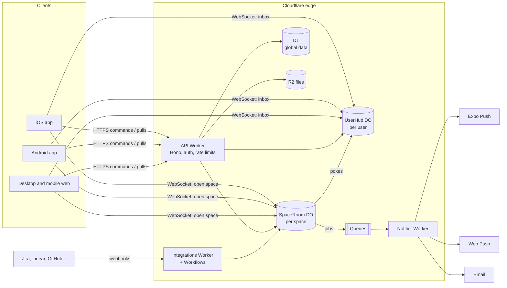

# Buildpair architecture

A clean-slate design for Buildpair, meant to seed a new repository (`buildpair`). It ignores the GoalBuddy code. Written 2026-10-10; prices and versions were checked that day (sources at the end).

## The decision in brief

- **One Expo app** (React Native, Expo SDK 57) for iOS, Android and the web. Desktop web gets its own layouts inside the same app.
- **Cloudflare for everything server-side**: Workers for the API, a **Durable Object per space** that owns that space's list and chat, a Durable Object per user for their inbox and reminders, **D1** for global data, **R2** for files, Queues and Workflows for background jobs.
- **SQLite everywhere**: inside each space's Durable Object (the space's source of truth), D1 (managed SQLite for global data), and on each device (the local copy that makes the app instant and work offline).
- **TypeScript end to end**, with one shared package of domain rules that runs on the device (optimistic updates) and on the server (authoritative updates).
- **GitHub Actions + EAS** for CI/CD: preview environments per pull request, staging on merge, gated production releases with gradual rollout and instant rollback.
- **Expected cost at 1,000 daily users: about $5–40 a month**, plus Apple's $99 a year.

## What we're designing for

| Assumption | Value |
|---|---|
| Daily active users | Up to 1,000 at first (about 3,000 monthly) |
| Typical space | 1–10 people; Discover may create spaces of 20–50 later |
| Spaces per user | 3–8 typical |
| Core loops | Tick an item (must feel instant), chat in a space (must feel seamless), see your people's progress live |
| Platforms | iOS, Android, desktop web (as good as the phone or better) |
| Team | Small, TypeScript-first, AI-assisted |
| Budget | Free tiers where possible, low fixed costs |
| Next big feature | Integrations (Jira first) |

The product's unit of everything is the **space**: a list plus one chat, shared with a few people. The architecture uses the same unit. Each space is a small, strongly consistent database that also runs the space's live connections, placed close to its members.

## The stack at a glance

| Layer | Choice | Why |
|---|---|---|
| App (iOS, Android, web) | Expo SDK 57 (React Native 0.86, React 19.2, New Architecture, Hermes V1), Expo Router, React Native Web 0.21 | One codebase for all three platforms; URL routing on the web; over-the-air JS updates. Bluesky ships its iOS, Android and web apps from a single React Native codebase. |
| Local data on device | SQLite (expo-sqlite) on iOS/Android, IndexedDB on the web, behind one storage interface | Instant screens from local data; works offline; survives restarts |
| Live connection | WebSockets via `partysocket` (auto-reconnect, buffers while offline) | Proven reconnect behavior; works in browsers and React Native |
| API | Hono on Cloudflare Workers, Zod schemas shared with the app | Runs at the edge near every user; no cold-start servers to manage |
| Space state and chat | One Durable Object per space with SQLite storage and the WebSocket Hibernation API | Single writer per space gives ordering for free; idle connections cost nothing; storage sits next to the live room. tldraw runs its multiplayer sync the same way (one Durable Object per room). |
| Per-user state | One Durable Object per user: their spaces, unread counts, devices, Activity inbox, reminder schedule | One socket per device; personal timers live with the person |
| Global data | Cloudflare D1 (SQLite) with read replication | Accounts, usernames, Buildpair IDs, invite links, Discover listings, offers, integrations, reports |
| Files | Cloudflare R2 | Avatars and attachments; no egress fees |
| Background work | Durable Object alarms, Queues, Cron Triggers, Workflows | Reminders and quiet-goal checks per space; fan-out of notifications; integration syncs with retries |
| Auth | Better Auth on Workers + D1 (email code, Sign in with Apple, Google; passkeys later) | Open source, data stays in our database, no per-user fees |
| Push | Expo Push Service (APNs/FCM) for phones, Web Push (VAPID) for desktop browsers | Free; one API for both phone platforms |
| Email | Cloudflare Email Sending (public beta; 3,000 a month included) with an adapter so SES or Resend can replace it | Sign-in codes, offers, opt-in summaries |
| Errors and analytics | Sentry (app and Workers), PostHog (product analytics, feature flags, session replay with text masked), Workers Logs | Free tiers cover this scale |
| CI/CD | GitHub Actions, Turborepo, EAS Build/Submit/Update, Wrangler, Terraform | Previews per PR; gated releases; reproducible infrastructure |

## System overview



## How the core works

### 1. Spaces are actors

Every space is a Durable Object called `SpaceRoom`. It is the only writer for that space, so every change gets the next number in the space's sequence. It stores, in its own SQLite database:

- members and roles, purpose, Discover switch
- items (to-dos, habits, goals and their steps), schedules, reminders, visibility ("only visible to me")
- item activity (done, skipped with reason, won't do)
- messages, reactions, read positions
- an append-only event log keyed by sequence number

Every person has a `UserHub` Durable Object holding their list of spaces (with last sequence and unread count), their devices and push tokens, their Activity inbox, and their personal agenda (which items are due when, so reminders and daily summaries fire from one place).

D1 holds what must be looked up across spaces: accounts and sessions, usernames and Buildpair IDs, invite links, Discover listings and offers, integration connections, blocks and reports.

Design rules that keep Durable Objects cheap and correct:

- Use the Hibernation WebSocket API and alarms, never in-memory timers, so idle rooms aren't billed for duration.
- Keep each room's schema version in its database and migrate lazily on wake.
- Pass a location hint when creating a space so it lives near its owner.

### 2. The sync protocol

The app never waits on the network to update the screen. Every change is a **command**; the server answers with **events**.

1. The app creates a command with its own ID (a ULID), applies it to the local copy immediately using the shared domain code, and stores it in a pending queue (persisted, so it survives restarts and offline periods).
2. The command goes to the space's `SpaceRoom` (over the open socket, or HTTPS when no socket is open). The room checks membership and permissions, applies it in a transaction with the same domain code, appends events with the next sequence numbers, and records the command ID so retries are harmless.
3. The room sends the events to every device that has the space open, and pokes each member's `UserHub`, which forwards a small notice (and the event itself, if small) to that person's other devices.
4. Each device applies events in sequence order and drops the matching pending command. If the room rejects a command, the app rolls it back and says why.
5. After a reconnect, the device asks for everything after its last sequence number. A device that has been away too long gets a snapshot instead.

Two refinements matter for this product:

- **Privacy filtering**: events about "only visible to me" items go only to their owner.
- **Today across spaces is a local query**: the device holds a copy of each of its spaces, so Today, Upcoming and search across your own spaces need no server round trip.

The protocol is small on purpose: one ordered log per space, which is how mature chat systems work. The commands and events are Zod schemas in a shared `protocol` package, versioned so older app versions keep working while new ones roll out.

### 3. Chat that feels seamless

- **Open instantly**: the last 50 messages come from the device's local copy; no spinner.
- **Send instantly**: the message shows immediately as pending, then gets its sequence number. It's queued while offline and sent on reconnect, with no duplicates (the command ID is the dedupe key).
- **Never out of order, never missing**: one sequence per space; a gap triggers a fetch.
- **Live presence and typing** come over the open space's socket, throttled and never stored.
- **Unread counts and read positions** are per member, kept in the room and mirrored to each `UserHub` for badges.
- **Push only when it helps**: no push if you're active in that space on any device; notifications group ("Alex and 4 others reacted 🔥").
- **Completions, skips, rolled-up to-dos and update notes** are written by the room as system messages in the same log, so the chat and the list can never disagree.
- **Keyboard and scrolling** done right on phones (react-native-keyboard-controller, a list that stays anchored to the newest message).
- **Attachments**: direct upload to R2 with a signed URL, then a message that references it.

### 4. Reminders and notifications

- Each `UserHub` keeps a personal agenda projected from the person's spaces and sets a single alarm for the next thing due: reminders, the morning summary, the weekly review prompt.
- Each `SpaceRoom` sets an alarm for its own checks: a goal gone quiet (nudges go only to supporters), weekly summary lines, offer expiry.
- Alarms put jobs on a Queue. The Notifier Worker decides the channel (phone push, browser push, email), applies quiet hours and grouping, and sends.

### 5. Discover and search

- When "Show on Discover" is on, the room writes a listing to D1 (purpose, goal summaries, time zone, wants, owner's top badge). Locked items are never included.
- "For you" starts as ranked SQL (similar goals, overlapping hours, time zone). Embeddings (Workers AI with Vectorize) can come later without changing the data flow.
- Offers live in D1 with a one-week expiry; the target room gets a "request" event for its chat line.

### 6. Integrations (the next big feature)

- An `Integrations` Worker runs OAuth connect flows (Jira Cloud first, then Linear and GitHub) and stores tokens encrypted in D1, with the key in Cloudflare's secret storage.
- Webhooks are verified, put on a Queue, and handled by a Workflow (durable, with retries) that turns an outside event into a normal command for the right `SpaceRoom` ("Fix invoice PDF bug" closed in Jira → item done → chat line).
- A small D1 index maps outside IDs to space and item. Cron-driven polling covers tools without webhooks.
- Each tool is an adapter behind one interface. Supporters see goal progress, never the backlog.
- Habit sources (Apple Health, Health Connect, Strava) fit the same shape; Apple Health data is read on the device and sent as commands.

### 7. Auth, safety and app-store rules

- Better Auth with email codes, Sign in with Apple and Google. Offering Google on iOS means offering Sign in with Apple too (App Store guideline 4.8).
- Bearer tokens in secure storage on phones, cookies on the web; sockets authenticate with a short-lived token.
- Turnstile on sign-up, the free WAF rules, and per-user rate limits on commands.
- User-generated content needs report and block (App Store guideline 1.2), and accounts must be deletable from inside the app. Deletion runs as a Workflow across D1, every room the person is in, and R2.

## The app

- **One Expo app** with Expo Router. Routes are real URLs on the web (`buildpair.app/spaces/life`), which also serve as deep links on phones.
- **Desktop layouts** live in platform files (`_layout.web.tsx`) inside the same app: sidebar, margin, popovers, right-click menus, keyboard shortcuts, Cmd+K. If React Native Web ever limits the desktop experience, the shared packages make a separate React DOM web app a contained project rather than a rewrite.
- **State**: synced data lives in the sync store (fed by the sync engine, read through selector hooks); screen-only state in small Zustand stores; one-off server requests (Discover search, profiles) through TanStack Query.
- **Libraries worth using**: Reanimated 4, FlashList v2 or Legend List for long lists and the chat view (spike both for chat), expo-image, expo-notifications, expo-secure-store, react-native-keyboard-controller, chrono-node (natural-language dates like "dentist friday 3pm"), rrule (repeats), a Temporal polyfill for time zones.
- **Landing page**: a separate static site (Astro) on Cloudflare, for speed and search engines.

## Repository layout

```
buildpair/
├── apps/
│   ├── app/          Expo app: iOS, Android, web
│   ├── edge/         Cloudflare Workers: api, SpaceRoom, UserHub, notifier, integrations
│   └── site/         Landing page (Astro, static)
├── packages/
│   ├── protocol/     Zod schemas for commands, events and API; versioned
│   ├── domain/       Pure rules shared by app and server: schedules, habit weeks, rollups, permissions
│   ├── sync/         App-side sync engine: local store, pending queue, socket, pulls
│   ├── ui/           Design tokens and primitives
│   └── config/       TypeScript and Biome settings
├── infra/            Terraform: DNS, WAF, R2, D1, Queues, Turnstile
└── .github/workflows/
```

The `domain` package is the key to correctness: the same code applies a command on the device (optimistically) and in the room (for real), so they can't drift apart.

## CI/CD

Tools: pnpm workspaces and Turborepo, Biome, TypeScript project references, Vitest (Workers and Durable Objects tested in the real runtime with `@cloudflare/vitest-pool-workers`), Playwright for the web, Maestro for phone flows, Changesets for release notes, Renovate for dependencies, gitleaks for secrets.

| Stage | Trigger | What runs |
|---|---|---|
| Checks | Every push and pull request | Install (cached), typecheck, lint and format, unit tests, Workers/DO tests, protocol compatibility tests (old app versions against the new server), sync simulation tests (many clients, dropped and reordered messages) |
| Preview | Pull request | Worker versions uploaded to a preview environment with its own D1 database and URL; web build on that URL; Playwright against it; EAS Update on a PR channel with a QR code posted to the PR |
| Staging | Merge to `main` | D1 migrations on staging, deploy Workers, smoke tests, EAS Update to the staging channel; Maestro flows nightly |
| Production | Release tag plus manual approval | Backward-compatible migrations first (expand, then contract in a later release), Workers gradual deployment (for example 10% → 50% → 100%) with rollback to the previous version in one command; JS-only app changes ship by EAS Update with a staged rollout; native changes trigger EAS Build and Submit to TestFlight and Play internal testing, then promotion |

Rules: protected `main`, required checks, CODEOWNERS, preview environments torn down when the PR closes, secrets only in GitHub Environments and Cloudflare. iOS builds run on EAS, not GitHub's macOS runners, to keep Actions minutes free. Approval gates on GitHub Environments are free on public repositories; private repositories need a paid GitHub plan for required reviewers.

Environments: local (Wrangler and Miniflare with local D1 and Durable Objects, Expo dev client), preview (per PR), staging, production.

## Operations

- **Backups**: D1 Time Travel and Durable Object SQLite point-in-time recovery (30 days), plus a nightly export to R2 for analytics and disaster recovery.
- **Monitoring**: Sentry alerts on new errors; PostHog dashboards for activation and retention; Workers Logs for request traces; Cloudflare billing notifications as a guard against runaway Durable Object duration.
- **Rollbacks**: Workers versions (previous version in one command), EAS Update rollbacks, and a feature flag on every risky feature.

## Cost at 1,000 daily users

| Item | Monthly cost | Notes |
|---|---|---|
| Cloudflare Workers Paid | $5 | Includes 10M Worker requests; Durable Objects 1M requests and 400,000 GB-s; DO SQLite 5 GB; D1 25B rows read, 50M written, 5 GB; Queues; 3,000 emails |
| Cloudflare overage | $0–5 | Mostly Durable Object requests (100 incoming WebSocket messages bill as 5 requests; outgoing are free) |
| R2 | $0 | Within the free allowance at this scale |
| Expo EAS | $0–19 | Free: 15 iOS + 15 Android builds and updates for 1,000 monthly users; Starter at $19 once more devices download updates |
| Email beyond 3,000 | $0–10 | $0.35 per 1,000; daily summaries should be opt-in |
| Sentry, PostHog, GitHub | $0 | Free tiers |
| Apple Developer Program | $8 | $99 a year; Google Play is $25 once |
| **Total** | **about $13–47** | |

## Alternatives considered

| Option | Why it isn't first | When it would win |
|---|---|---|
| Postgres + Zero 1.0 (sync engine) | Excellent local-first sync on Postgres, but needs an always-on `zero-cache` container with a direct logical-replication connection, so Postgres never scales to zero; a second vendor and region hop; presence still needs something else | If we want everything relational and expect heavy cross-space queries |
| Convex | Fastest to build and reactive by default, but one region, $25 per developer per month beyond 1M function calls and 1 GB bandwidth, not offline-first, proprietary data model | If shipping the first version fast matters more than latency and cost |
| Supabase | Postgres, auth and realtime in one, but free projects pause after 7 idle days, Pro is $25 with compute billed around the clock, one region, and the app's sync layer is still ours to build | If the team wants plain Postgres with the least setup |
| Firebase | Realtime and offline SDKs, but NoSQL lock-in, per-read pricing that climbs with live listeners, complex rules | If we were Android/Google-centric and document-shaped |
| AWS | $100–200 in credits for 6 months, then pay; more services to wire for WebSockets (API Gateway, Lambda, DynamoDB or RDS); one region | If an investor or partner requires AWS |
| Hosted chat (Stream and similar) | Chat is the product and is woven into items (rollups, completions, updates); data lives elsewhere; price jumps after free tiers | If chat were a side feature |
| Flutter, or native iOS + Android + separate web | Flutter's web output feels less like a website; native means three codebases | If we hit performance limits React Native can't solve |

## Risks and how we handle them

| Risk | Mitigation |
|---|---|
| Bugs in our own sync layer | Keep the protocol tiny; share domain code; simulation tests with many clients and bad networks; build it first (milestone 1) |
| Cloudflare lock-in | Room logic behind a storage interface; standard SQLite and Drizzle schemas; Hono code is portable; Postgres is reachable later through Hyperdrive if needed |
| Durable Object costs if hibernation breaks | No timers in rooms (lint rule), alarms only; billing alerts |
| Email Sending is in beta | Email adapter with SES or Resend as drop-in fallbacks |
| Desktop polish on React Native Web | Desktop layouts in web-only files; shared packages keep a React DOM web app possible |
| App store review | Sign in with Apple, report and block, in-app account deletion, privacy labels from day one |

## Build order

1. **Foundations (week 1)**: repo, CI with previews, environments, auth, a hello-world space on iOS, Android and web.
2. **Spaces and chat**: `SpaceRoom`, `UserHub`, the sync protocol, chat with reactions, offline queue and push. This is the riskiest part, so it goes first.
3. **Items**: to-dos, habits, goals, schedules, natural-language adding, Today, reminders.
4. **People**: invites, roles, Activity, Supporting, quiet-goal nudges.
5. **Discover**: listings, offers, requests; profiles, badges, compliments.
6. **Desktop extras and beta**: Cmd+K, Upcoming, weekly review, polish.
7. **Integrations**: Jira first.

## Open decisions for the owner

- The Buildpair domain (needed for links, app deep links and email reputation).
- Public or private repository (public gets free code scanning and approval gates).
- Sign-in methods at launch (recommended: email code, Apple, Google).
- Analytics consent approach for EU users.

## Sources (checked 2026-10-10)

- Cloudflare: [Workers pricing](https://developers.cloudflare.com/workers/platform/pricing/), [Durable Objects pricing](https://developers.cloudflare.com/durable-objects/platform/pricing), [DO SQLite storage billing](https://developers.cloudflare.com/changelog/2026-01-07-durable-objects-sqlite-storage-billing), [D1 pricing](https://developers.cloudflare.com/d1/platform/pricing/), [Queues on the free plan](https://developers.cloudflare.com/changelog/2026-02-04-queues-free-plan/), [Hyperdrive pricing](https://developers.cloudflare.com/hyperdrive/platform/pricing), [Email Sending public beta](https://developers.cloudflare.com/changelog/post/2026-04-16-email-sending-public-beta/), [Email Service pricing](https://developers.cloudflare.com/email-service/platform/pricing/)
- Expo: [SDK 57](https://expo.dev/changelog/sdk-57), [SDK 55 (New Architecture only)](https://expo.dev/changelog/sdk-55), [plans](https://docs.expo.dev/billing/plans/), [pricing](https://expo.dev/pricing)
- Precedents: [tldraw sync on Durable Objects](https://github.com/tldraw/tldraw-sync-cloudflare), [Bluesky social-app](https://github.com/bluesky-social/social-app)
- Libraries: [PartyServer / partysocket](https://npmjs.com/package/partyserver), [Zero 1.0 (InfoQ)](https://infoq.com/news/2026/06/zero-version-1), [Zero deployment](https://zero.rocicorp.dev/docs/deployment)
- Alternatives: [Convex plans](https://www.convex.dev/plans), [Supabase pricing overview](https://makerkit.dev/blog/saas/supabase-pricing), [Neon pricing overview](https://www.jetadmin.io/blog/neon-review/), [AWS Free Tier](https://aws.amazon.com/free)
- Tooling: [GitHub Actions 2026 pricing](https://resources.github.com/actions/2026-pricing-changes-for-github-actions/), [Sentry vs PostHog free tiers](https://posthog.com/blog/posthog-vs-sentry)
